<h1 align="center">Wedding Website</h1>

<p align="center">
  <strong>Self-host the whole wedding, not just the website.</strong><br>
  An admin panel deep enough to actually run a wedding from — RSVPs and a guest list,
  a seating chart, a budget, a photo gallery, a registry — and a private honeymoon
  planner with a map. One Docker image, on your own server.
</p>

<p align="center">
  <a href="https://nextjs.org"></a>
  <a href="https://react.dev"></a>
  <a href="https://www.typescriptlang.org"></a>
  <a href="https://tailwindcss.com"></a>
  <a href="https://www.postgresql.org"></a>
  <a href="https://www.docker.com"></a>
  <a href="https://developer.mozilla.org/en-US/docs/Web/Progressive_web_apps"></a>
</p>

<p align="center">
  <a href="#languages"></a>
</p>

<p align="center">
  <a href="https://weddingwebsitedemo.com">
    
  </a>
  &nbsp;
  <a href="https://github.com/Soccerbeats/weddingwebsite/wiki">
    
  </a>
</p>

<p align="center">
  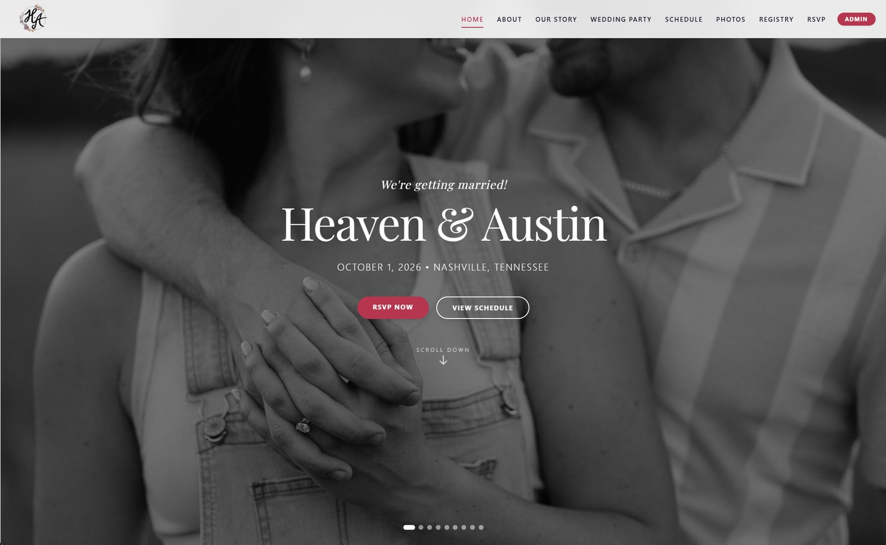
</p>

<p align="center">
  <a href="https://weddingwebsitedemo.com"><strong>Try it →&nbsp; weddingwebsitedemo.com</strong></a><br>
  A completely fictional wedding — ninety guests, a budget, a seating chart and a
  sixteen-day honeymoon. No login: the whole admin panel is open, so change
  anything you like. Nothing there is real and nothing you do to it is saved.<br>
  <sub>Run your own with one compose file and one environment variable —
  <a href="https://github.com/Soccerbeats/weddingwebsite/wiki/The-Demo-Instance">how the demo works</a>.</sub>
</p>

## What it does

**For guests** — a home page with a hero slideshow and a countdown, your story as
a timeline, the wedding party, the schedule (one day, or the whole weekend day by
day), a photo gallery, a registry with
a honeymoon fund, and an RSVP form that recognises them by name (accents and all —
"Noren" finds "Norén") where each person answers for themself and answers any
questions you add. **In your guests' language: English, Spanish, German, Swedish
or Russian** — see [Languages](#languages).

**For you** — an admin panel covering:

- **RSVPs and guests** — import a CSV, track a hundred-odd people and their
  parties, dietary notes, addresses, and export a mailing list; plus the two of
  you (seatable and fed, never counted as invited) and a **vendors** list for the
  photographer, the DJ and anyone else who needs a plate
- **Seating** — draw the room, drop tables in it, drag guests into seats — or
  work the same plan as a list, grouped by table or by guest, with multi-select
  and bulk moves; then **export it** for the caterer, as paper or a spreadsheet,
  with guest plates, vendor plates and a grand total for the kitchen
- **Money** — a real budget: lines you drag into the order and the section you
  want them in, quantities, who is paying, who has contributed, what is still
  owed and when it is due — including a bar charged per **drinker**, so the
  under-21s on your guest list stay out of it
- **Photos** — upload, drag to reorder, heart the ones that go public, and give
  the home page and footer a portrait photo of their own for phones
- **Content** — every page's text, colours, and a work-in-progress toggle per page
- **Honeymoon** — a private planner *and* a trip companion: a map of everywhere
  you are considering, a day-by-day itinerary with real driving times and honest
  arrival times, an accommodation shortlist you can rank, compare and rule out
  without deleting, **travel entered as whole tickets** (every leg, both times,
  the layovers judged) that place themselves on the right days, booking details
  with cancellation deadlines, a trip budget that adds up, weather and daylight
  per day, a phone-first **Today** view that works offline, and a read-only link
  for the other half of the couple

Full list: **[Features](https://github.com/Soccerbeats/weddingwebsite/wiki/Features)**.

## Quick start

The image is on GitHub Container Registry, so there is nothing to build:

```bash
cp docker/.env.example docker/.env        # set POSTGRES_PASSWORD and ADMIN_PASSWORD
docker compose -f docker/docker-compose.prod.yml up -d
```

Then open `http://localhost:3000`, and `/admin` with the password you set.
(`docker/docker-compose.dev.yml` is the development stack — it builds from source
instead of pulling the image.)

It builds with no network beyond npm: the fonts ship with the app rather than
being fetched from Google Fonts, and guests' browsers never ask a font service
for anything. Under `npm run dev` the offline mode is off, so a change shows on
the next reload rather than behind a saved copy
(`NEXT_PUBLIC_OFFLINE_IN_DEV=true` turns it on).

Everything works with those two variables. The rest of `docker/.env.example` is
optional and each feature says so in the UI when its variable is missing:

| Variable | Turns on |
|---|---|
| `JWT_SECRET` | A session cookie signed independently of the admin password |
| `SMTP_HOST` / `SMTP_PORT` / `SMTP_USER` / `SMTP_PASS` / `SMTP_FROM` / `NOTIFICATION_EMAIL` | Email when an RSVP arrives |
| `FLIGHT_API_KEY` | *Fill in from schedule* on a travel leg — a RapidAPI key subscribed to AeroDataBox |
| `GEOCODER_USER_AGENT` | Identifies you to OpenStreetMap's geocoder, which refuses anonymous-looking callers. Worth setting |
| `NOMINATIM_URL` / `OSRM_URL` | Your own geocoder / routing server instead of the public ones |
| `SITE_URL` | The URL the RSVP links point at (the request's own host if it is not set) |

- **[Installation](https://github.com/Soccerbeats/weddingwebsite/wiki/Installation)** — Portainer, plain Compose, or local
- **[Deployment](https://github.com/Soccerbeats/weddingwebsite/wiki/Deployment)** — what a merge publishes, and how it reaches a running server on its own
- **[The demo instance](https://github.com/Soccerbeats/weddingwebsite/wiki/The-Demo-Instance)** — how the read-only copy at [weddingwebsitedemo.com](https://weddingwebsitedemo.com) is put together, and how to host your own

## Languages

The guest-facing site speaks five languages:

| | Language | |
|---|---|---|
| 🇬🇧 | **English** | the default |
| 🇪🇸 | **Español** | Spanish |
| 🇩🇪 | **Deutsch** | German |
| 🇸🇪 | **Svenska** | Swedish |
| 🇷🇺 | **Русский** | Russian |

**To change it:** Admin → **Settings** → **Site language**, and pick one. It saves
itself, and every guest sees the new language from their next page load.

What changes:

- every button, heading and label on the public pages
- the RSVP form, from the name lookup to the confirmation
- the emails guests receive: the RSVP link, and the confirmation with their answers
- dates, written the language's own way ("1. Mai 2027", "1 мая 2027 г.")
- counts, with each language's plural rules (Russian's four forms included)

What stays as you wrote it: everything you type yourself — your names, your
story, the FAQs, the schedule, the wedding party, the registry items and your
RSVP questions. Write those in your guests' language. The admin panel stays in
English.

**Adding a language** is one file: copy `src/lib/i18n/en.ts` to a new file,
translate the strings, and register it in `src/lib/i18n/locales.ts` and
`src/lib/i18n/messages.ts`. TypeScript refuses to build until every message is
there, and `npm run check:i18n` checks that every `{placeholder}` and every plural
form the language needs made it across.

## Email (SMTP)

RSVPs can trigger two emails, and the admin can check that they would work:

1. **The guest gets a confirmation** — "We received your RSVP!", signed with the
   names from your settings, the moment they answer.
2. **You get a notification** — their name, their answer, the headcount, their
   contact details and any message they left.
3. **You can test it first.** *Admin → Settings → Email (SMTP)* shows whether
   the mail is configured (and which host it would use) and whether a test
   recipient is set, and **Send test email** mails the notification address —
   so you find out about a bad password before your first RSVP, not after.

Nothing is sent until the variables are set: an unset mail is a supported
state, the RSVPs simply do not email, and the admin's Settings page says so.

| Variable | What it is |
|---|---|
| `SMTP_HOST` | Your SMTP server's address |
| `SMTP_PORT` | `587` (STARTTLS) or `465` (implicit TLS) |
| `SMTP_USER` | The SMTP login — also the from address unless `SMTP_FROM` is set |
| `SMTP_PASS` | Its password — an app password, not your login password |
| `SMTP_FROM` | Optional. The from address, when it differs from the login (Brevo's login is not a mailbox) |
| `NOTIFICATION_EMAIL` | Where the "new RSVP" mail goes, and where the test mail goes |

**A working example (Brevo).** A free Brevo account: `SMTP_HOST` is
`smtp-relay.brevo.com`, `SMTP_PORT` is `587`, `SMTP_USER` is the Brevo SMTP
user it assigns you, and `SMTP_PASS` is the SMTP password you generate in
Brevo's *SMTP, API and Webhooks* settings (it is not your account password).
Set `NOTIFICATION_EMAIL` to an address you have verified in Brevo.

**On a Portainer stack**, set the variables in the stack's **Environment**.
The compose files pass them through as `${VAR:-}` — so a variable set on the
stack but missing from the compose file never reaches the container, and one
listed but unset arrives as an empty string, which is exactly the
"unconfigured" state. To see what the container actually has, run
`docker exec <web container> printenv SMTP_HOST`.

## RSVP links

RSVPs go by email link: a guest types their name — anyone in the party can
use their own — and the site mails them a link to the address it already
holds for their household. The link opens the RSVP form with the household
already filled in, and submitting sends the link's token along with the
answers.

- **The link carries a signed token, good for 60 minutes, and nothing
  else.** No names, no email addresses, no details. It is signed with the
  same key as the admin session (`JWT_SECRET`, falling back to
  `ADMIN_PASSWORD`), so there is nothing extra to set — and with neither
  set, no links are issued at all.
- **`SITE_URL`** is optional. When it is set, the link points at it (a
  trailing slash is stripped); otherwise the link is built from the
  request's own host, which is also where the protocol comes from (`X-
  Forwarded-Proto` behind a proxy, `http` otherwise).
- **The gate.** A household on the guest list can only be RSVP'd through a
  valid link minted for it — the write is refused without one, and the name
  lookup answers only "that name is on the list, and it is this seat of the
  party" rather than the household's contact details. A name the guest list
  does not know behaves exactly as before: nothing is written, no link is
  needed.

## Screenshots

> Every screenshot below comes from the [live demo](https://weddingwebsitedemo.com),
> so the couple, guests, budget and honeymoon in them are fictional — and every
> screen here is one you can go and click through yourself.

### The public site

| Home | Our Story |
|---|---|
| 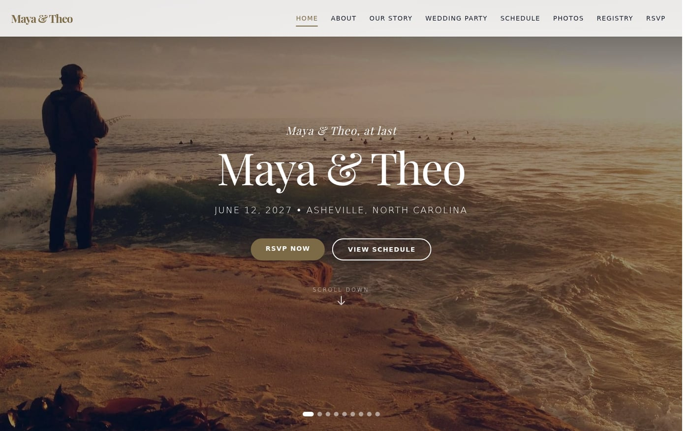 | 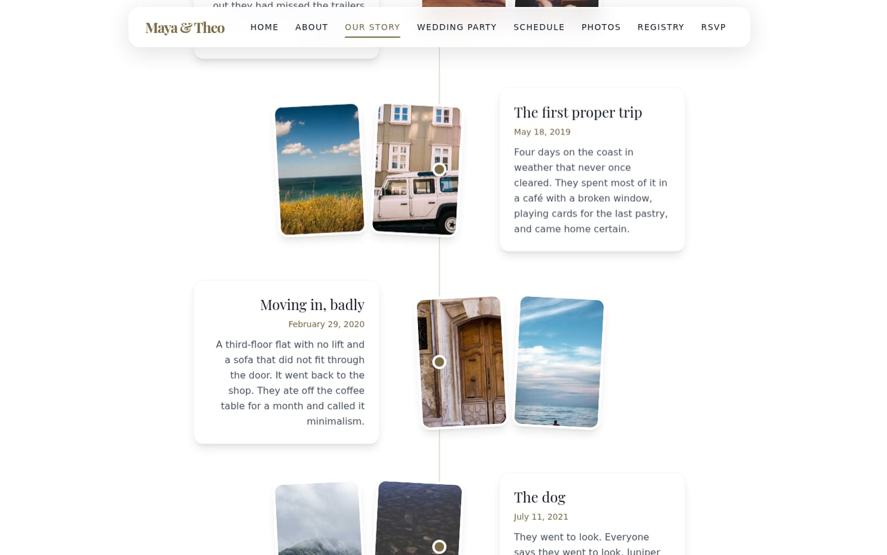 |
| The hero slideshow, countdown and intro | A vertical timeline that alternates sides |

| Wedding Party | Schedule |
|---|---|
| 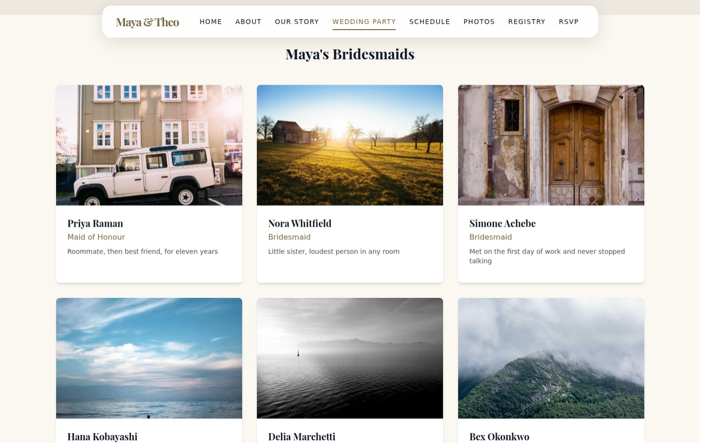 | 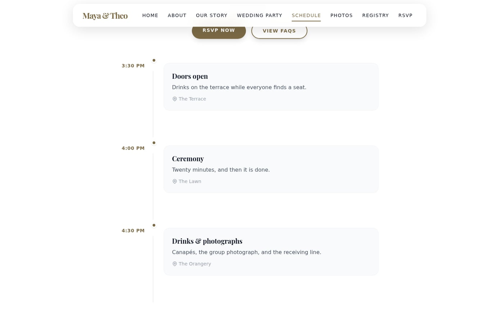 |
| Cards for each side of the party | The day in order, with times and locations |

| Registry | Photos |
|---|---|
| 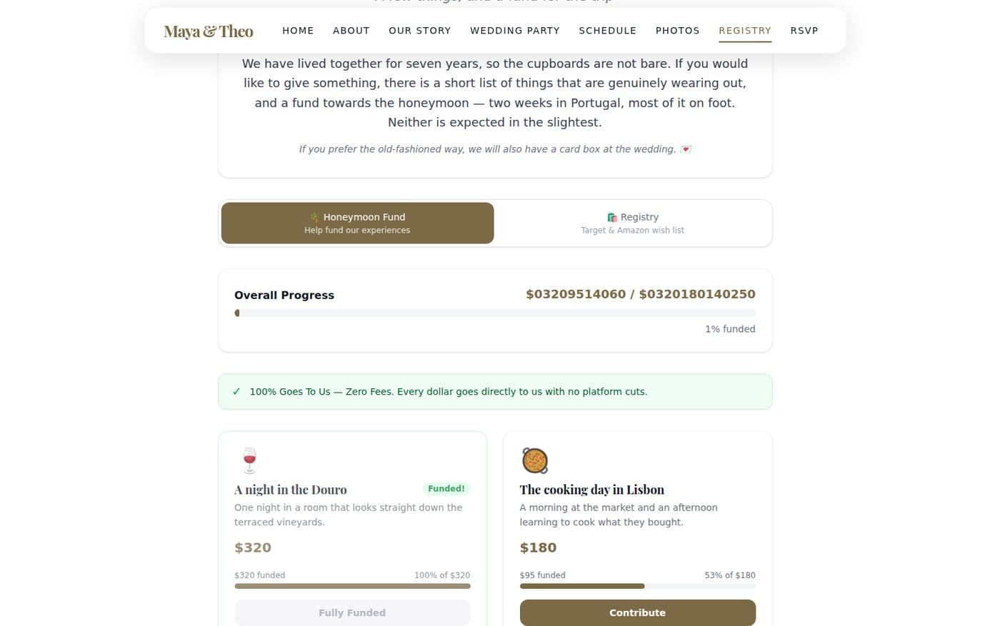 | 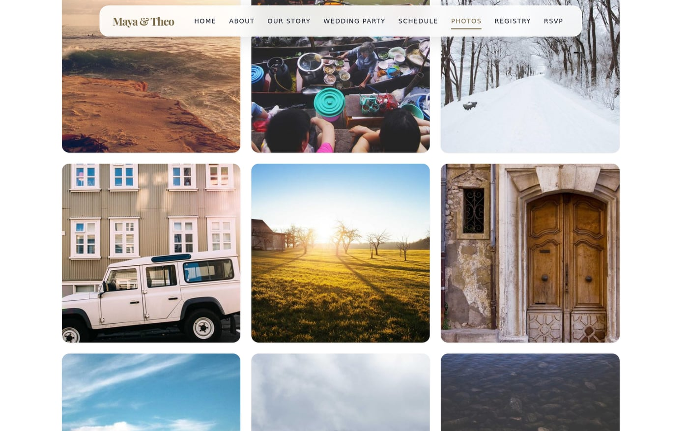 |
| A honeymoon fund with progress, plus a product registry | The gallery, which shows only your hearted photographs |

### The admin panel

| Dashboard | RSVPs & guests |
|---|---|
| 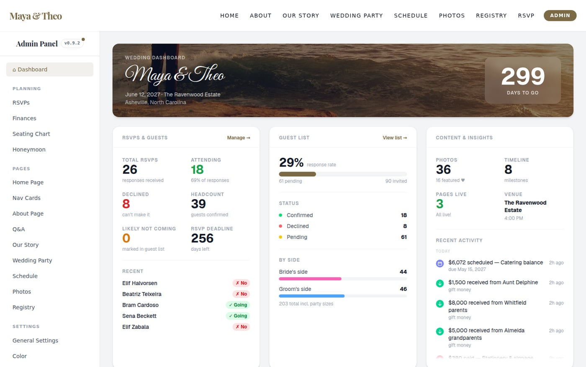 | 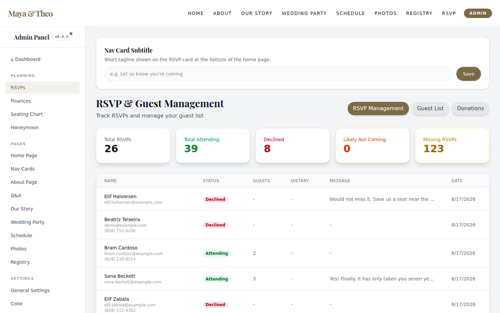 |
| Where everything stands, at a glance | Ninety guests, filterable, with party members as sub-rows |

| Finances | Seating chart |
|---|---|
| 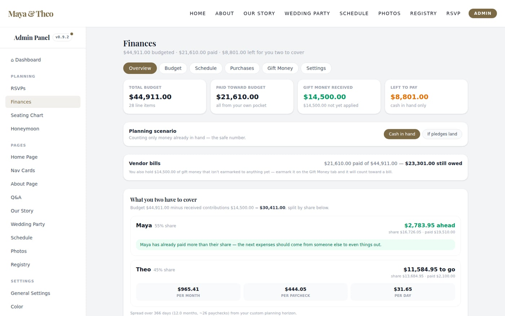 | 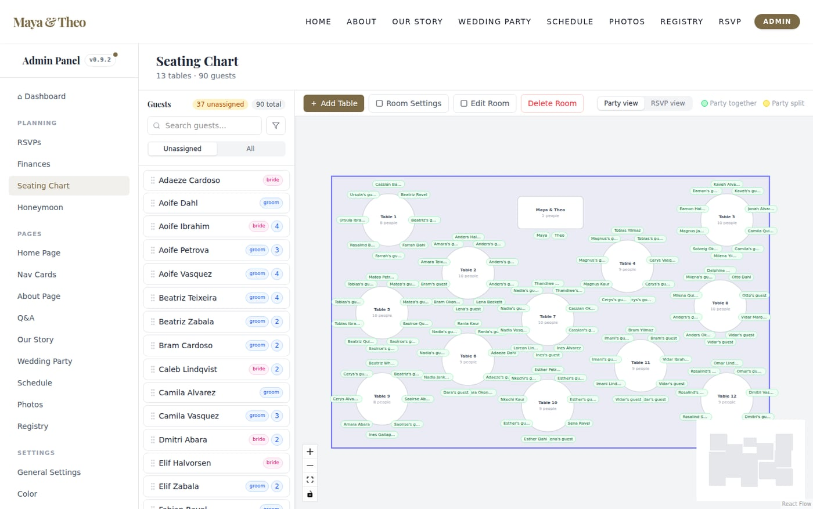 |
| A real budget: lines, payers, contributors, what is left | Drag guests onto tables — or work the same plan as a list |

| Photos | Changelog |
|---|---|
| 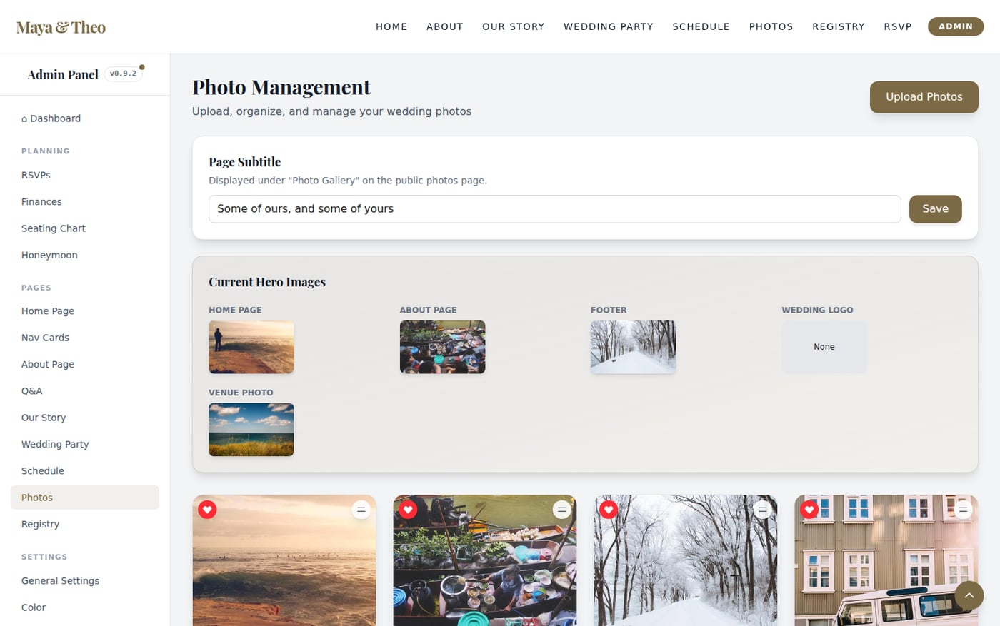 | 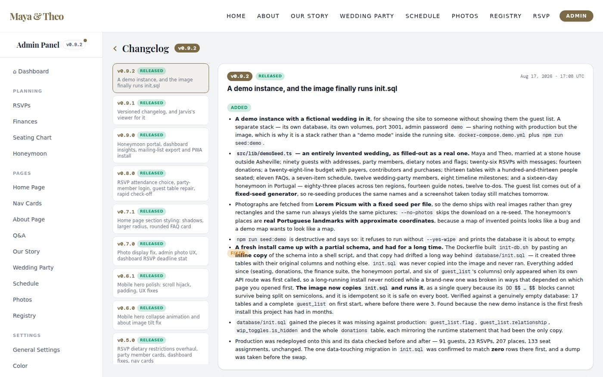 |
| Drag to reorder, heart to publish | Every release, read in the panel — see [Versions and the changelog](https://github.com/Soccerbeats/weddingwebsite/wiki/Versions-and-the-Changelog) |

### Seating, and the sheet for the caterer

One plan, two views — a floor plan you drag people onto, or the same plan as a
list with multi-select and bulk moves (which is what a phone opens, since touch
has no drag-and-drop). Then **Export**, for the people who need it on paper:

1. **Put yourselves on the guest list.** On *RSVPs & Guests → Guest List* a
   banner offers **Add the couple** — one row holding both of you, named from
   your settings. You can then be seated like any party, and your plates are
   counted, without being counted as invited to your own wedding.
2. **Add the vendors.** The *Vendors* tab: the photographer, the DJ, the
   planner — name, role, company, contact, whether their contract includes a
   meal, and what they cannot eat. One row is one person. They never take a
   chair.
3. **Export.** Options on the left, a live preview of the real sheet on the
   right. Choose *By table* / *A–Z* / both, and *Every name* / *Counts only* /
   both. Turn on **Vendors** to include them.
4. **Print or download.** Paper gives you a kitchen summary — guest plates,
   vendor plates and a grand total — a block per table, and the vendors.
   *Counts only* fits on one page: three columns, no vendor roster, and if it is
   still over, the sheet is shrunk by exactly the amount it needs (it refuses to
   go below 60% and tells you instead). The spreadsheet is one row per person,
   with each restriction its own column so a pivot totals them.

Guests answer with five restrictions plus **Kids' Meal** and **Not Eating** — the
latter being a seat with no plate against it, for the baby whose food comes with
their mother. So the kitchen total counts *plates*, which stops being the
headcount the moment anyone is not eating. A plate with no answer on it prints as
**chicken**: the RSVP form has never asked for an entrée, so that is the whole of
what can honestly be said.

Full details in
[Seating and the Export](https://github.com/Soccerbeats/weddingwebsite/wiki/Seating-and-the-Export).

### The honeymoon portal

Private planning for the trip, and the thing you actually open on it. Admin-only,
with no public page — except a read-only link you can hand to one person.

**Planning it.** Every candidate on one clustered map over four base layers
(streets, satellite, terrain, clean), with a measure tool and drawable region
boundaries; a place library that imports from a spreadsheet, Google My Maps or a
Google Takeout and exports as CSV, GeoJSON or KML; a shortlist you can rank,
compare side by side and triage one card at a time; per-person ratings and
comments, because two people rate one shortlist; photos, opening hours and
"best time to go" on a place; and a booking vault holding the confirmation
number, what it cost, what is paid and the date after which cancelling costs
you.

**Getting there.** Travel is entered as a **journey** — one ticket, however many
legs. Paste the flight numbers off the confirmation and each leg is looked up and
filled in (times, terminals, aircraft, both time zones) and placed on the right
trip day by itself: the dates decide, not a dropdown. Layovers are computed
across zones and judged — tight, impossible, or a different airport, which is a
transfer rather than a connection — and a landing time carries "that's 21:00 back
home" whenever the leg crosses zones.

**Making it work.** Driving times from a router instead of straight lines, a
day laid out as a timeline that says when you actually arrive and which stops you
cannot make, weather (a forecast inside sixteen days, a decade of normals beyond
it), sunrise and sunset, and a conflicts panel that collects everything wrong
with the plan — a night with nowhere to sleep, two stays booked over the same
nights, a booking whose dates disagree with the days it covers.

**Finding your way around.** Ten tabs — Overview, Today, Itinerary, Map,
Places (with Stays and Excursions as segments of it), Travel, Checklist, Files,
Guide and Settings — each with the same toolbar along its top. Click a place anywhere,
on the map, a list, a stay card, a stop on a day or a search result, and the same
panel opens: everything about it, editable where it stands. The itinerary's
Timeline view draws each day against the clock, flights and drives included,
with check-out and check-in marked. On a phone the portal is its own app: one
slim bar on top, tabs along the bottom, one day at a time with a swipe, and a
vertical agenda for the timeline.

**Files.** Passports, visas, insurance, tickets and booking confirmations in a
file explorer of their own: folders by kind and by person, thumbnails, a viewer
that steps through them, and warnings that matter at a desk — a passport with
under six months left after you come home, a policy that ends mid-trip. Every
file is kept on the device for offline use, and the page says how many are.

**Offline, all of it — and editable.** Install the site to a phone's home
screen and it saves itself — every page, its data, the photos the site shows
(not the rest of the photo library), the map tiles and hotel photos you looked
at — so it opens on a plane or at a border with no signal. Every time you open
the app it asks the server whether anything changed and brings its copy up to
date on its own.

It works like Mail: every page and its data come from the copy on the phone
first, at once, and the server is asked behind it. When the server has
something newer, the dashboard and the honeymoon portal update in place and any
other page shows *Updated on the server · Refresh* (it never swaps a form out
from under you). Anything you have just saved is always read back from the
server, never from an older copy. Pull down at the top of any admin page to
refresh — with no signal it says *Couldn't connect* and leaves everything as it
was.

With no signal you can keep editing. Changes are kept on the phone, shown
straight away (the honeymoon portal and the site settings show them exactly as
they will land), and sent by themselves, in order, the next time the app opens
with a connection — "Sending 3 changes made offline…". To use it:

1. Install the site to the home screen and open it once with a connection
   (sign in to the admin, so the admin pages are saved too).
2. Offline, use it as normal. The bar at the top says you are offline and how
   many changes are waiting.
3. Back online, open the app. The changes go up; if the session has expired
   the bar says *Sign in to send* — sign in and they go. Anything the server
   refuses is listed with the reason, under *Details*.

Uploads, share links, archive restores and outside lookups (weather, driving
times, flight details) still need a connection and say so.

**Taking it with you.** A Today view built for one thumb, cached by a service
worker so it opens with no signal; an emergency card with the local numbers as
tap-to-call buttons; a calendar you can subscribe to rather than download; a
print sheet you can fold into a passport; and a documents folder for the
passports, visas and insurance you would be sorry to be without.

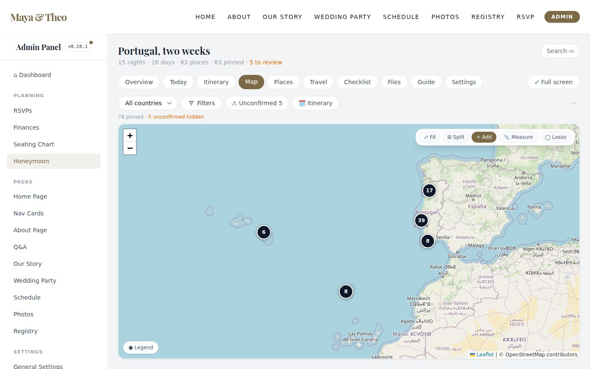

*Every place on one map, clustered, filterable, and fitted to whatever is showing.*

| Itinerary | Calendar |
|---|---|
| 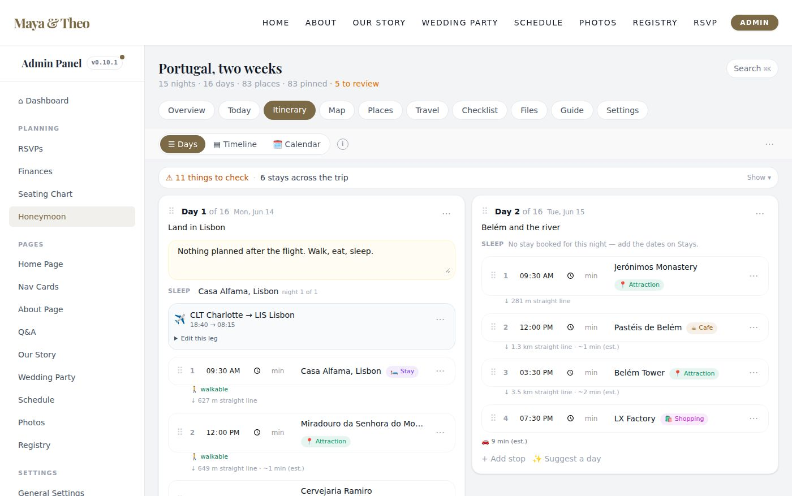 | 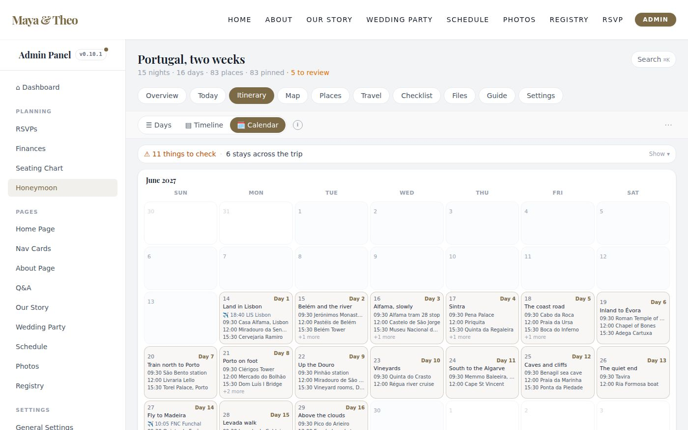 |
| Days with a base, travel legs and timed stops | The same trip on a real calendar |

| Timeline | One place panel |
|---|---|
| 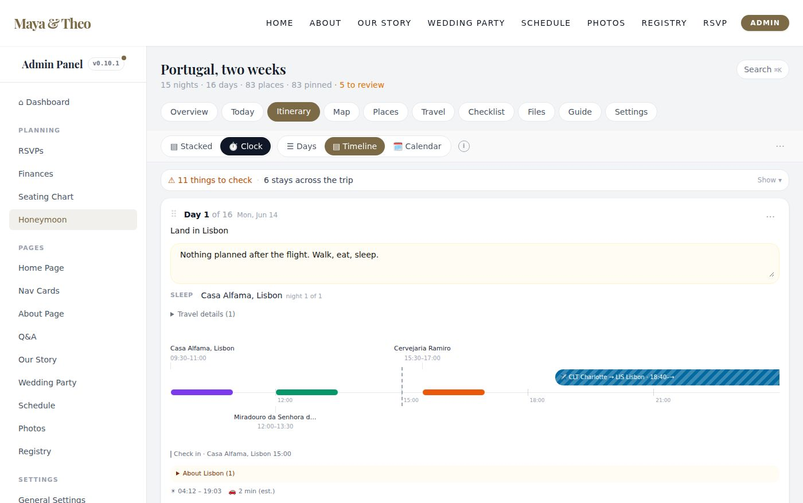 | 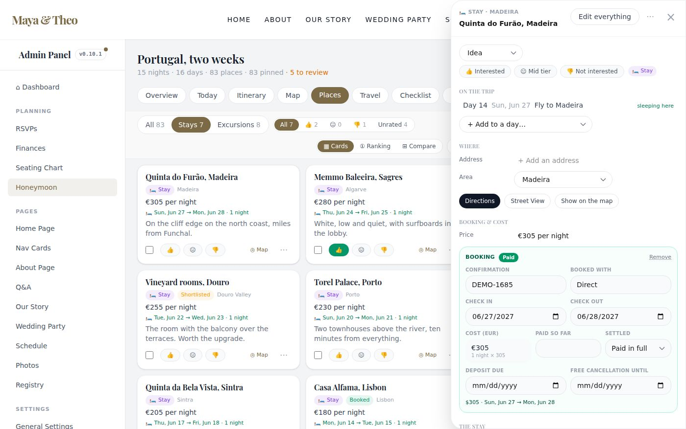 |
| A day against the clock, travel and check-in included | The same panel wherever you click a place |

| Overview | Files |
|---|---|
| 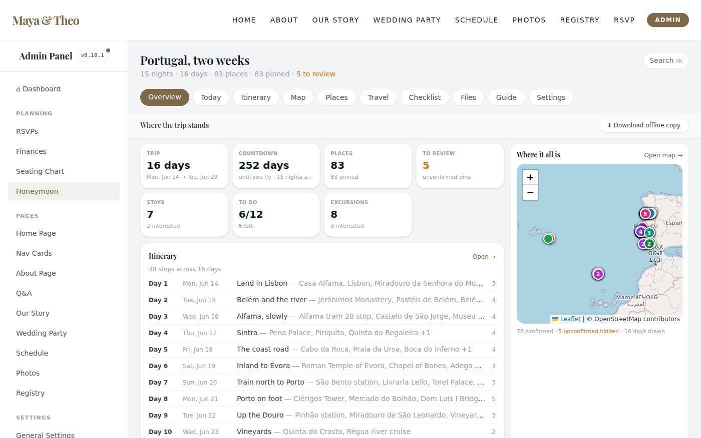 | 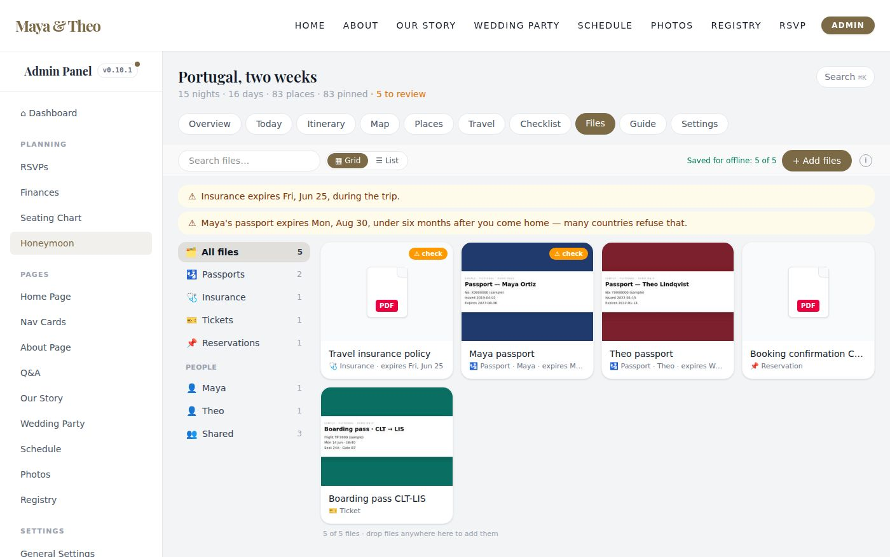 |
| The whole trip on one page | Every travel document, checked against the dates and saved for offline |

| Guide | |
|---|---|
| 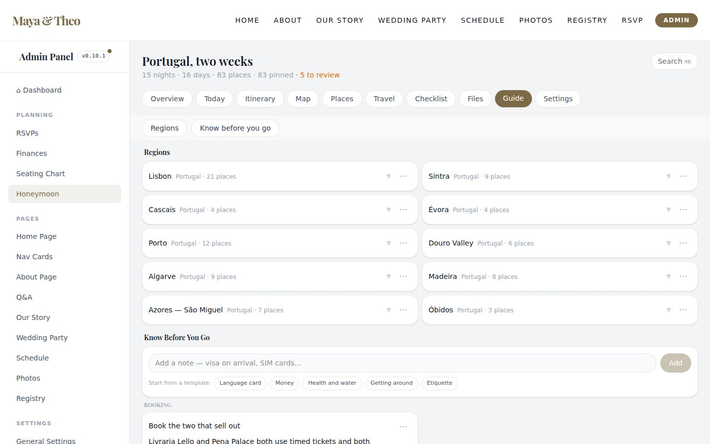 | |
| Region write-ups and everything with no coordinates | |

> Screenshots from the fictional demo trip, v0.10.1. The documents shown are
> generated samples marked as such.

### On a phone

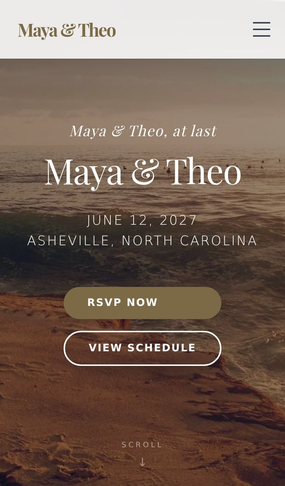

## Changelog

Every release is written up in [CHANGELOG.md](CHANGELOG.md), which is also the
source of truth for the app's version — the topmost `vX.Y.Z` is what the admin
panel displays.

## License

**Free for your wedding. Ask me about anything commercial.**

Source-available under the [PolyForm Noncommercial License 1.0.0](LICENSE.md) —
not an open-source license, deliberately. Run it for your own wedding or a
friend's, read it, change it, self-host it, share your changes: all free, no
permission needed. Charities, schools, public research bodies and government
institutions count as noncommercial too.

Selling it, hosting it as a paid service, or building client sites with it needs
a separate license. That conversation is welcome and the answer is not
automatically no — [open an issue](https://github.com/Soccerbeats/weddingwebsite/issues)
and let's talk.

Dependencies keep their own licenses — the bundled fonts (Playfair Display, Great
Vibes, Geist) are under the SIL Open Font License, in
[`src/app/fonts/LICENSE.md`](src/app/fonts/LICENSE.md) — and whatever a deployment holds — the
photographs, the guest list, the names — belongs to whoever put it there.
